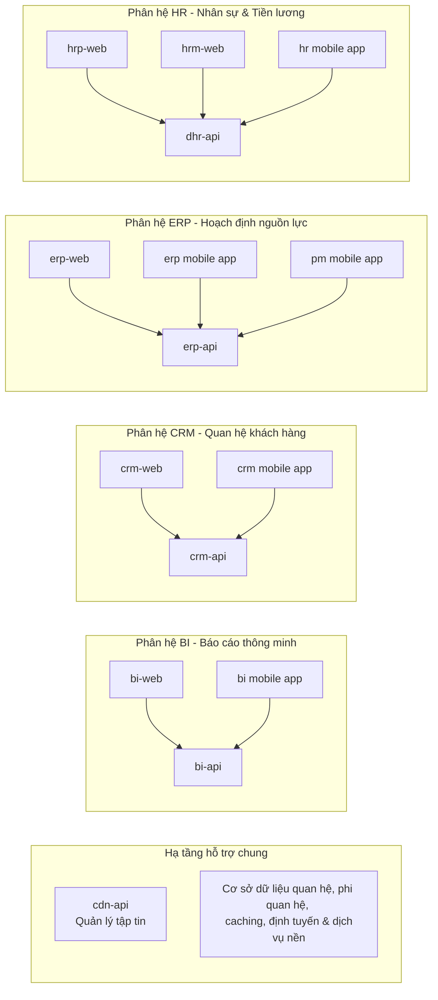
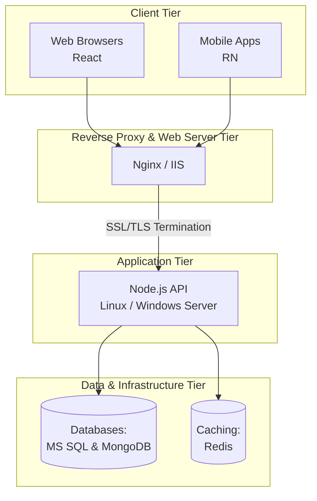
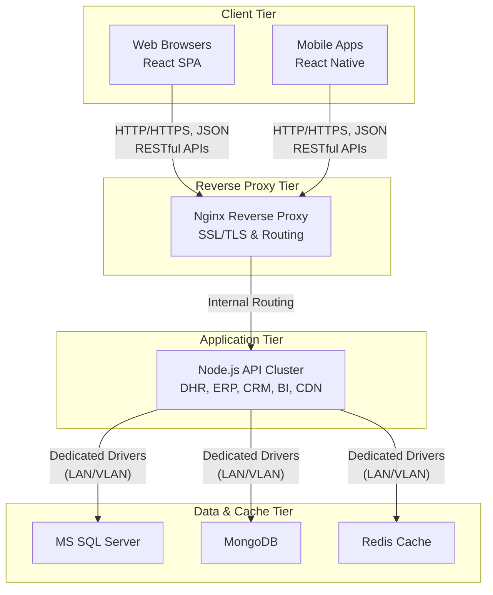
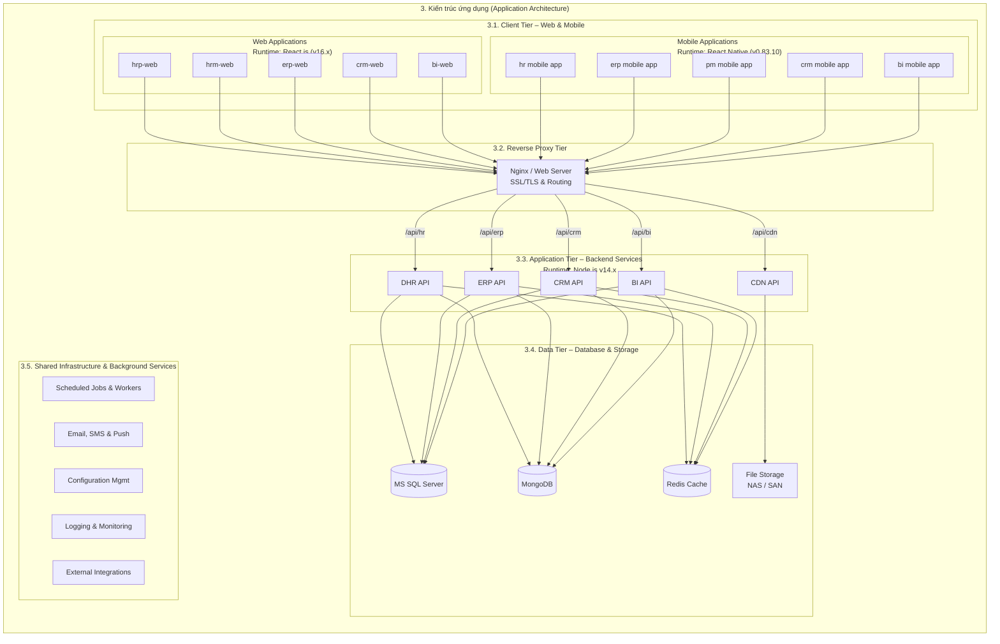

# TECHNOLOGY STACK ARCHITECTURE

## 1. Giới thiệu

### 1.1. Mục đích tài liệu
Tài liệu này cung cấp bức tranh toàn cảnh và chi tiết về kiến trúc công nghệ của hệ thống (bao gồm các phân hệ Web và Mobile). Tài liệu định hướng cấu trúc hệ thống, phân rã các tầng ứng dụng, định nghĩa các công nghệ đang sử dụng (Current Stack), đánh giá rủi ro, đồng thời đưa ra lộ trình nâng cấp công nghệ (Recommended Stack) nhằm đảm bảo tính bảo mật, hiệu năng và khả năng mở rộng dài hạn.

### 1.2. Phạm vi hệ thống
Hệ thống bao gồm các phân hệ cốt lõi phục vụ vận hành doanh nghiệp:
* **Phân hệ HR (Nhân sự & Tiền lương):** Quản lý hồ sơ nhân sự, chấm công, tính lương (`hrp-web`, `hrm-web`, `dhr-api`, `hr mobile app`).
* **Phân hệ ERP (Hoạch định nguồn lực):** Quản lý nghiệp vụ kho, tài chính, sản xuất (`erp-web`, `erp-api`, `erp mobile app`, `pm mobile app`).
* **Phân hệ CRM (Quan hệ khách hàng):** Quản lý thông tin khách hàng, cơ hội bán hàng, chăm sóc khách hàng (`crm-web`, `crm-api`, `crm mobile app`).
* **Phân hệ BI (Báo cáo thông minh):** Tổng hợp dữ liệu, trực quan hóa và báo cáo phân tích (`bi-web`, `bi-api`, `bi mobile app`).
* **Hạ tầng hỗ trợ chung:** Quản lý tập tin (`cdn-api`), cơ sở dữ liệu quan hệ, phi quan hệ, caching, định tuyến và dịch vụ nền.

### 1.3. Đối tượng sử dụng tài liệu
* **Đội ngũ Phát triển Phần mềm (Developers):** Nắm rõ cấu trúc phân hệ, công nghệ, API endpoints và tiêu chuẩn mã nguồn.
* **Đội ngũ Vận hành & Hạ tầng (DevOps / SysAdmins):** Thiết lập môi trường máy chủ, cấu hình Nginx, PM2, quản lý cơ sở dữ liệu và bảo mật hệ thống.
* **Quản lý dự án (Architects / PMs):** Theo dõi lộ trình nâng cấp công nghệ, đánh giá rủi ro kỹ thuật và lập kế hoạch phân bổ nguồn lực.

### 1.4. Thuật ngữ và định nghĩa

* **SPA (Single Page Application):** Ứng dụng trang đơn chạy trên nền tảng React.js.
* **LTS (Long Term Support):** Phiên bản phần mềm được hỗ trợ dài hạn, đảm bảo ổn định và vá lỗi bảo mật.
* **EOL (End of Life):** Thời điểm chấm dứt hỗ trợ chính thức đối với phần mềm/hệ điều hành.
* **CDN (Content Delivery Network):** Mạng phân phối nội dung và tài nguyên tĩnh.

---

## 2. Tổng quan hệ thống

### 2.1. Danh sách sản phẩm và phân hệ
Hệ thống được thiết kế theo mô hình đa nền tảng (Web & Mobile Apps) kết nối tới các dịch vụ Backend độc lập theo từng nghiệp vụ:
* **Nhóm Nhân sự (HR):** `hrp-web`, `hrm-web`, `hr mobile app` ➔ kết nối `dhr-api`.
* **Nhóm Quản trị Doanh nghiệp (ERP & PM):** `erp-web`, `erp mobile app`, `pm mobile app` ➔ kết nối `erp-api`.
* **Nhóm Quan hệ Khách hàng (CRM):** `crm-web`, `crm mobile app` ➔ kết nối `crm-api`.
* **Nhóm Báo cáo & Phân tích (BI):** `bi-web`, `bi mobile app` ➔ kết nối `bi-api`.
* **Nhóm Dịch vụ chung:** `cdn-api` quản lý tài nguyên, tập tin tĩnh.

### 2.2. Tổng quan các thành phần công nghệ
Hệ thống bao gồm 3 tầng kiến trúc chính:
1. **Client Tier:** Giao diện người dùng trên Web (React) và Mobile (React Native).
2. **Application Tier:** Tầng xử lý logic nghiệp vụ bằng Node.js chạy trên máy chủ Linux quản lý bởi Nginx và PM2.
3. **Data & Infrastructure Tier:** Cơ sở dữ liệu quan hệ MS SQL Server, NoSQL MongoDB, bộ nhớ đệm Redis, và các dịch vụ nền (Cron Jobs, Mail, Logs).

### 2.3. Sơ đồ kiến trúc tổng quan

### 2.4. Mô hình giao tiếp giữa các thành phần
* Giao tiếp giữa Client (Web/Mobile) và Application Server thực hiện thông qua giao thức **HTTP/HTTPS** sử dụng định dạng **JSON** qua RESTful APIs.
* Giao tiếp giữa Application Server và Database/Cache thông qua các driver chuyên dụng kết nối nội bộ bảo mật trong mạng LAN/VLAN của hệ thống.

---

## 3. Kiến trúc ứng dụng (Application Architecture)

### 3.1. Client Tier – Web & Mobile
#### 3.1.1. Web Applications
Xây dựng theo mô hình SPA (Single Page Application), chạy trực tiếp trên các trình duyệt hiện đại, tối ưu hóa trải nghiệm người dùng với tốc độ phản hồi nhanh.

#### 3.1.2. Mobile Applications
Ứng dụng di động đa nền tảng (Android và iOS) được phát triển đồng bộ, chia sẻ logic xử lý và giao diện cơ bản.

#### 3.1.3. Frontend Technology Stack
* **Web Frontend:** React.js *(Hiện tại: v16.x ➔ Mục tiêu nâng cấp: v18.x / v19.x)*.
* **Mobile Frontend:** React Native `v0.83.10` hỗ trợ kiến trúc mới (New Architecture - Fabric & TurboModules).

### 3.2. Reverse Proxy Tier
#### 3.2.1. Nginx / Web Server
Đóng vai trò là cổng tiếp nhận toàn bộ request từ bên ngoài vào hệ thống.

#### 3.2.2. Routing và SSL/TLS Termination
* Cấu hình điều hướng request (`/api/hr` ➔ `dhr-api`, `/api/erp` ➔ `erp-api`,...).
* Quản lý chứng chỉ SSL/TLS, mã hóa dữ liệu đường truyền HTTPS và tối ưu nén tài nguyên tĩnh.

### 3.3. Application Tier – Backend Services
Toàn bộ Backend được phát triển trên nền tảng **Node.js** *(Hiện tại: v14.x)* chạy trên hệ điều hành **CentOS 7**.

#### 3.3.1. DHR API
Xử lý toàn bộ logic nghiệp vụ nhân sự, tính lương, quản lý chấm công và duyệt nghỉ phép.

#### 3.3.2. ERP API
Xử lý nghiệp vụ cốt lõi của doanh nghiệp bao gồm quản lý kho hàng, tài chính kế toán và sản xuất.

#### 3.3.3. CRM API
Xử lý dữ liệu khách hàng, quản lý phễu bán hàng, hợp đồng và chăm sóc khách hàng.

#### 3.3.4. BI API
Xử lý truy vấn dữ liệu tổng hợp, phục vụ kết xuất báo cáo thống kê và phân tích thông minh.

#### 3.3.5. CDN API
Quản lý việc tải lên, lưu trữ và phân phối các tập tin media, tài liệu đính kèm của hệ thống.

#### 3.3.6. Backend Technology Stack
* **Runtime:** Node.js v14.x (Khuyến nghị nâng cấp lên v22/24 LTS).
* **Process Manager:** PM2 (Quản lý tiến trình cluster, tự động phục hồi).

### 3.4. Data Tier – Database & Storage
#### 3.4.1. Microsoft SQL Server
Lưu trữ dữ liệu quan hệ cốt lõi có tính toàn vẹn cao của các phân hệ ERP, HR, CRM.

#### 3.4.2. MongoDB
Cơ sở dữ liệu NoSQL lưu trữ linh hoạt cho các dữ liệu log, cấu hình động và biểu mẫu không đồng nhất.

#### 3.4.3. Redis
Bộ nhớ đệm (In-memory cache) tăng tốc độ truy vấn, lưu trữ phiên làm việc (session) và hàng đợi tác vụ ngầm (Queue).

#### 3.4.4. File Storage
Lưu trữ tệp tin đính kèm trên hệ thống đĩa cứng gắn ngoài (NAS/SAN) hoặc thư mục chia sẻ bảo mật trên server.

### 3.5. Shared Infrastructure & Background Services
#### 3.5.1. Scheduled Jobs và Background Workers
Thực thi các tác vụ định kỳ tự động (cron jobs) như chạy bảng lương tháng, tổng hợp báo cáo đêm, đồng bộ dữ liệu.

#### 3.5.2. Email, SMS và Push Notifications
Hệ thống dịch vụ tích hợp gửi thông báo đa kênh đến người dùng qua Email, tin nhắn SMS hoặc thông báo đẩy trên ứng dụng di động.

#### 3.5.3. Configuration Management
Quản lý các thông số cấu hình hệ thống, biến môi trường tập trung và an toàn.

#### 3.5.4. Logging và Monitoring
Ghi nhận toàn bộ User Audit Logs, System Logs và API Access Logs phục vụ kiểm tra và gỡ lỗi.

#### 3.5.5. External Integrations
Tích hợp dịch vụ bên thứ ba (Cổng thanh toán, hóa đơn điện tử, dịch vụ chữ ký số).

---

## 4. Kiến trúc triển khai (Deployment Architecture)

### 4.1. Mô hình triển khai hệ thống
Hệ thống được triển khai theo mô hình phân tầng trên môi trường On-Premise, tách biệt rõ ràng giữa cụm Frontend, cụm Backend API và Cụm Cơ sở dữ liệu.

### 4.2. Máy chủ và hệ điều hành
* **Hệ điều hành hiện tại:** CentOS 7 *(Lưu ý: Đã EOL, cần lộ trình chuyển đổi sang Rocky Linux 9 / AlmaLinux 9)*.

### 4.3. Runtime và Process Management
* Ứng dụng Node.js chạy dưới sự quản lý của **PM2** ở chế độ Cluster Mode, tận dụng tối đa đa nhân CPU của máy chủ.

### 4.4. Network, Ports và Firewall
* **Cổng công khai (Public Ports):** `80` (HTTP), `443` (HTTPS - qua Nginx).
* **Cổng nội bộ (Internal Ports):** Các API chạy trên các cổng riêng biệt (`3001` tới `3005`) chỉ chấp nhận kết nối từ Nginx local hoặc mạng nội bộ.
* **Firewall:** Cấu hình `firewalld` hoặc `ufw` chặn tất cả các port chưa được ủy quyền.

### 4.5. Mô hình triển khai Development, UAT và Production
* **Development:** Môi trường lập trình cục bộ của lập trình viên.
* **UAT (Staging):** Môi trường kiểm thử tích hợp, mô phỏng giống Production để kiểm duyệt tính năng.
* **Production:** Môi trường vận hành chính thức phục vụ người dùng cuối.

### 4.6. Phân bổ dịch vụ trên máy chủ
* Phân tách Server Database riêng biệt với Server ứng dụng Node.js để tối ưu hóa tài nguyên phần cứng (CPU/RAM/Disk I/O).

### 4.7. Luồng kết nối và phụ thuộc giữa các dịch vụ
* Client ➔ Nginx ➔ Node.js API ➔ SQL/MongoDB/Redis. Các dịch vụ có cơ chế tự retry khi mất kết nối tạm thời với database.

---

## 5. Bảo mật và vận hành hệ thống

### 5.1. Authentication và Authorization
* Sử dụng xác thực người dùng thông qua chuẩn **JWT (JSON Web Token)** kết hợp phân quyền chi tiết theo vai trò (RBAC) cho từng phân hệ.

### 5.2. API Security và Access Control
* Áp dụng cơ chế Rate Limiting trên Nginx để chống tấn công DDoS và Brute-force API.
* Kiểm tra dữ liệu đầu vào (Input Validation) bằng các thư viện chuẩn hóa (Joi/Zod).

### 5.3. TLS/SSL và Network Security
* Bắt buộc sử dụng HTTPS cho toàn bộ kênh truyền dữ liệu từ Client đến Server. Cấu hình bảo mật TLS 1.2/1.3.

### 5.4. Quản lý cấu hình và thông tin nhạy cảm
* Các thông tin nhạy cảm như chuỗi kết nối database (Connection string), khóa bí mật JWT Secret được lưu trữ trong tệp `.env` bảo mật, tuyệt đối không đưa lên mã nguồn công khai (Git).

### 5.5. Logging, Monitoring và Alerting
* Theo dõi trạng thái sức khỏe dịch vụ (Health Check), giám sát tài nguyên CPU/RAM qua PM2 và hệ thống cảnh báo khi tiến trình gặp sự cố.

### 5.6. Backup và Recovery
* Thiết lập lịch tự động sao lưu cơ sở dữ liệu (MS SQL Server và MongoDB) định kỳ hằng ngày/hằng tuần và lưu trữ tại phân vùng độc lập.

### 5.7. Quản lý lỗi và khả năng phục hồi
* Bắt lỗi toàn cục (Global Error Handler) trong ứng dụng Node.js để tránh sập toàn bộ tiến trình khi phát sinh ngoại lệ chưa bắt được.

---

## 6. Danh mục công nghệ hiện tại (Technology Inventory)

### 6.1. Frontend Technology
* **Web:** React.js (v16.x)

Frontend của hệ thống được phát triển trên nền tảng **React (v16.8.6)** kết hợp với **TypeScript (v3.6.4)**, quản lý trạng thái bằng **Redux / Redux-Saga** và sử dụng hệ sinh thái các thư viện phong phú phục vụ giao diện, biểu đồ, lịch biểu và xử lý dữ liệu:

| Nhóm chức năng | Thư viện / Công nghệ | Phiên bản | Mô tả chi tiết |
| --- | --- | --- | --- |
| **Core Framework & State** | `react`, `react-dom` | v16.8.6 | Thư viện cốt lõi xây dựng giao diện người dùng dựa trên Component |
|  | `typescript` | v3.6.4 | Hỗ trợ lập trình kiểu dữ liệu tĩnh, nâng cao độ an toàn và bảo trì code |
|  | `react-router` | v3.0.0 | Quản lý định tuyến và điều hướng trang |
|  | `redux` | v3.6.0 | Quản lý trạng thái toàn cục (State Management) |
|  | `react-redux` | v7.1.0-rc.1 | Thư viện kết nối Redux với React |
|  | `redux-saga` | v0.16.0 | Xử lý tác vụ bất đồng bộ thông qua Generator functions |
|  | `redux-thunk` | v2.2.0 | Middleware cho phép viết action creator trả về hàm |
| **UI Components & Styling** | `antd` | v4.2.4 | Bộ UI Component Ant Design xây dựng giao diện doanh nghiệp |
|  | `@material-ui/core` | v4.9.10 | Thư viện Material-UI core |
|  | `diginet-core-ui` | v1.2.13 | Thư viện component nội bộ phục vụ hệ thống |
|  | `@material-ui/lab` | v4.0.0-alpha.49 | Các thành phần thử nghiệm của Material-UI |
|  | `@material-ui/icons` | v4.5.1 | Thư viện biểu tượng Material Design |
|  | `bootstrap` | v3.4.1 | Hệ thống lưới và giao diện CSS cơ bản |
|  | `react-bootstrap` | v0.31.5 | Component Bootstrap tích hợp cho React |
|  | `reactstrap` | v7.1.0 | Thư viện Bootstrap 4 cho React |
|  | `styled-components` | v4.3.1 | Viết CSS-in-JS quản lý style theo component |
|  | `node-sass` | v4.14.1 | Biên dịch file Sass/SCSS sang CSS |
|  | `classnames` | v2.2.6 | Kết hợp tên lớp CSS linh hoạt |
| **Biểu đồ & Sơ đồ (Charts & Diagrams)** | `chart.js` | v2.8.0 | Thư viện vẽ biểu đồ thống kê trực quan |
|  | `@dabeng/react-orgchart` | v1.0.0 | Xây dựng sơ đồ tổ chức nhân sự (Org Chart) cho phân hệ HR |
|  | `devextreme`, `devextreme-react` | v20.1.7 | Bộ công cụ giao diện nâng cao, hỗ trợ bảng dữ liệu (DataGrid) và biểu đồ phức tạp |
| **Lịch biểu & Thời gian (Calendar & Date)** | `@fullcalendar/react`, `@fullcalendar/core`, `@fullcalendar/daygrid`, `@fullcalendar/interaction` | v5.x | Xây dựng lịch công tác, quản lý sự kiện và tương tác kéo thả ngày tháng |
|  | `moment` | v2.24.0 | Thao tác, định dạng và xử lý thời gian/ngày tháng |
|  | `moment-timezone` | v0.5.28 | Hỗ trợ quản lý và chuyển đổi múi giờ cho moment |
|  | `date-fns` | v2.0.0-beta.5 | Thư viện xử lý ngày tháng nhẹ nhàng, hiện đại |
|  | `@material-ui/pickers` | v3.2.7 | Bộ chọn ngày tháng cho Material-UI |
|  | `react-date-range` | v1.0.3 | Component chọn khoảng thời gian (Date Range Picker) |
|  | `@date-io/date-fns` | v1.3.11 | Thư viện adapter kết nối date-fns với các pickers |
| **Xử lý Tài liệu & Biểu mẫu** | `@tinymce/tinymce-react` | v3.6.1 | Trình soạn thảo văn bản Rich Text Editor TinyMCE |
|  | `draft-js` | v0.11.7 | Khung soạn thảo văn bản mã nguồn mở từ Facebook |
|  | `draftjs-to-html` | v0.8.4 | Chuyển đổi dữ liệu Draft-js sang mã HTML |
|  | `jspdf` | v2.3.0 | Thư viện tạo file PDF trực tiếp từ client |
|  | `html2canvas` | v1.0.0-rc.7 | Chụp ảnh nội dung giao diện HTML trực tiếp từ trình duyệt |
|  | `validator` | v7.0.0 | Kiểm tra và làm sạch chuỗi dữ liệu |
|  | `crypto-js` | v4.0.0 | Thư viện mã hóa bảo mật thông tin phía client |
| **Tiện ích tương tác & Khác** | `react-beautiful-dnd` | v13.0.0 | Hỗ trợ tính năng kéo thả (Drag and Drop) mượt mà |
|  | `axios` | v0.27.2 *(lưu ý: từ bản backend/chung)* / hoặc các gọi API khác | Thực hiện gọi API HTTP |
|  | `firebase` | v7.1.5 | Tích hợp dịch vụ đám mây và xác thực/thông báo thời gian thực |
|  | `dexie` | v3.0.3 | Quản lý cơ sở dữ liệu IndexedDB phía client lưu trữ ngoại tuyến |

* **Mobile:** React Native (`v0.83.10`)

Phần ứng dụng di động của hệ thống được phát triển trên nền tảng **React Native (`v0.83.10`)** 

| Nhóm chức năng | Thư viện / Công nghệ | Phiên bản | Mô tả chi tiết |
| --- | --- | --- | --- |
| **Core Framework & State** | `react`, `react-native` | `v19.2.0`, `v0.83.10` | Thư viện cốt lõi xây dựng ứng dụng di động đa nền tảng |
|  | `expo` | `~55.0.31` | Nền tảng công cụ và dịch vụ hỗ trợ phát triển React Native |
|  | `redux`, `react-redux`, `redux-saga`, `redux-logger` | đa phiên bản | Quản lý trạng thái toàn cục (State Management) và xử lý tác vụ bất đồng bộ |
| **Navigation & UI Layout** | `@react-navigation/native`, `@react-navigation/native-stack`, `@react-navigation/stack` | đa phiên bản | Hệ thống điều hướng và chuyển màn hình (Navigation) |
|  | `@gorhom/bottom-sheet`, `react-native-modal`, `react-native-swipeout` | đa phiên bản | Hỗ trợ hiển thị bảng trượt đáy (Bottom Sheet), cửa sổ pop-up (Modal) và vuốt tương tác |
|  | `diginet-core-mobile` | `1.1.3` | Thư viện component nội bộ phục vụ phân hệ di động doanh nghiệp |
|  | `react-native-elements`, `react-native-tab-view`, `react-native-pager-view` | đa phiên bản | Bộ UI Component và các thành phần phân trang, chia tab giao diện |
|  | `react-native-vector-icons`, `react-native-svg` | đa phiên bản | Hỗ trợ hiển thị biểu tượng (Icons) và đồ họa vector SVG |
|  | `react-native-linear-gradient`, `react-native-shimmer-placeholder`, `react-content-loader` | đa phiên bản | Hiệu ứng chuyển màu, khung giữ chỗ tải dữ liệu (Shimmer/Skeleton) |
| **Định vị & Thiết bị (Location & Device)** | `expo-location` | `~55.1.14` | Cung cấp dịch vụ định vị GPS và tọa độ người dùng |
|  | `react-native-maps` | `1.27.2` | Tích hợp bản đồ trực quan trên thiết bị di động |
|  | `react-native-device-info`, `react-native-netinfo` | đa phiên bản | Lấy thông tin thiết bị và kiểm tra trạng thái kết nối mạng |
|  | `react-native-permissions`, `react-native-android-open-settings` | đa phiên bản | Quản lý quyền truy cập hệ thống và cài đặt thiết bị di động |
| **Camera, Media & Document** | `react-native-vision-camera`, `react-native-image-crop-picker` | đa phiên bản | Tích hợp camera nâng cao và công cụ cắt/chọn ảnh |
|  | `react-native-image-viewing`, `react-native-view-shot` | đa phiên bản | Trình xem ảnh chi tiết và chụp ảnh màn hình ứng dụng |
|  | `react-native-webview`, `react-native-autoheight-webview` | đa phiên bản | Hiển thị nội dung web và tài liệu trực tiếp trong ứng dụng |
|  | `react-native-blob-util`, `react-native-share` | đa phiên bản | Xử lý tệp tin nhị phân, tải xuống và chia sẻ tài liệu |
| **Thông báo & Cập nhật OTA** | `expo-notifications`, `@react-native-firebase/messaging` | đa phiên bản | Quản lý thông báo đẩy (Push Notifications) và tích hợp Firebase Cloud Messaging |
|  | `hot-updater`, `@hot-updater/react-native`, `@hot-updater/server` | `0.28.0` | Giải pháp cập nhật ứng dụng qua mạng không dây (OTA Update) |
| **Lưu trữ & Bảo mật (Storage & Security)** | `@react-native-async-storage/async-storage` | `2.2.0` | Lưu trữ dữ liệu khóa-giá trị cục bộ trên thiết bị |
|  | `react-native-keychain` | `10.0.0` | Lưu trữ thông tin nhạy cảm và mật khẩu an toàn (Keychain/Keystore) |
|  | `crypto-js`, `validator` | đa phiên bản | Mã hóa dữ liệu bảo mật và kiểm tra tính hợp lệ dữ liệu |
| **Tiện ích thời gian & Khác** | `moment`, `date-fns` | đa phiên bản | Thao tác, định dạng và xử lý ngày tháng, thời gian |
|  | `@react-native-community/datetimepicker`, `react-native-calendar-picker`, `react-native-modal-datetime-picker` | đa phiên bản | Bộ chọn ngày giờ, lịch biểu cho nền tảng di động |
|  | `axios` | `0.21.1` | Thực hiện gọi API HTTP/HTTPS kết nối backend |
|  | `react-native-restart` | `0.0.29` | Hỗ trợ khởi động lại ứng dụng từ mã nguồn |

### 6.2. Backend Technology

Backend của hệ thống được phát triển trên nền tảng **Node.js** sử dụng framework **Sails.js**, kết hợp với hệ sinh thái các gói thư viện quan trọng phục vụ xử lý nghiệp vụ doanh nghiệp, tài liệu, xác thực và kết nối cơ sở dữ liệu:
Dưới đây là bảng tổng hợp các công nghệ và thư viện backend của hệ thống, được phân loại theo từng nhóm chức năng để dễ theo dõi:

| Nhóm chức năng | Thư viện / Công nghệ | Phiên bản | Mô tả chi tiết |
| --- | --- | --- | --- |
| **Core Framework & Server** | `sails` | v1.5.2 | Framework chính xây dựng cấu trúc MVC và RESTful APIs cho backend |
|  | `express-rate-limit` | v6.5.1 | Giới hạn tần suất gọi API, phòng chống tấn công DDoS và Brute-force |
|  | `dotenv` | v8.2.0 | Quản lý biến môi trường và cấu hình bảo mật hệ thống |
| **Database & Caching** | `mssql` | v7.3.5 | Kết nối và thao tác với hệ cơ sở dữ liệu quan hệ Microsoft SQL Server |
|  | `sails-mongo` | v2.0.1 | Adapter kết nối và thao tác với cơ sở dữ liệu NoSQL MongoDB |
|  | `ioredis`, `@sailshq/connect-redis`, `@sailshq/socket.io-redis` | - | Quản lý Redis để lưu cache, quản lý session và đồng bộ socket |
| **Xác thực & Bảo mật** | `jsonwebtoken` | v8.3.0 | Tạo và xác thực JWT phục vụ phân quyền người dùng |
|  | `openid-client`, `activedirectory` | v5.7.1, v0.7.2 | Tích hợp xác thực một lần (SSO) và đồng bộ tài khoản Active Directory doanh nghiệp |
|  | `sanitize-html` | v2.13.1 | Làm sạch dữ liệu đầu vào HTML nhằm phòng chống lỗ hổng XSS |
|  | `joi`, `@hapi/joi-date` | v17.3.0, v2.0.1 | Kiểm tra, chuẩn hóa và validate tính hợp lệ của dữ liệu đầu vào theo schema |
| **Xử lý Tài liệu & Báo cáo** | `exceljs` | v4.4.0 | Đọc, ghi và xử lý tệp tin bảng tính Excel phức tạp trong nghiệp vụ ERP/HR |
|  | `docx-templates`, `docx-merger`, `html-docx-js` | v4.9.2, v1.2.2, v0.3.1 | Tự động sinh, trộn dữ liệu và xuất biểu mẫu tài liệu Word |
|  | `pdf-signer`, `html-pdf` | v1.1.4, 3.0.1 | Chuyển đổi HTML sang PDF và hỗ trợ ký số chứng thực tài liệu |
|  | `archiver`, `adm-zip` | v5.3.0, v0.5.16 | Đóng gói và giải nén các tệp tin lưu trữ hệ thống |
|  | `cloudmersive-convert-api-client` | v2.0.3 | Dịch vụ chuyển đổi định dạng tài liệu nâng cao |
| **Tiện ích & Tác vụ nền** | `axios` | v0.27.2 | Thực hiện gọi HTTP/HTTPS requests tích hợp dịch vụ bên thứ ba |
|  | `node-schedule` | v1.3.2 | Lên lịch và thực thi các tác vụ nền tự động định kỳ (Cron jobs) |
|  | `nodemailer`, `mail-notifier` | v6.5.0, v0.5.0 | Gửi và quản lý thông báo qua hệ thống email |
|  | `uuid`, `md5` | v8.3.2, v2.2.1 | Tạo mã định danh duy nhất và hỗ trợ mã hóa băm dữ liệu |
|  | `moment` | v2.23.0 | Thao tác, định dạng và xử lý thời gian/ngày tháng |

### 6.3. Database và Storage
* **SQL:** MS SQL Server
* **NoSQL:** MongoDB
* **Cache:** Redis

### 6.4. Infrastructure và DevOps Tools
* **OS:** CentOS 7
* **Version Control:** Git / GitLab / GitHub

### 6.5. Phiên bản, trạng thái hỗ trợ và phụ thuộc
* **CentOS 7:** Đã kết thúc hỗ trợ chính thức (EOL).
* **Node.js 14:** Đã kết thúc vòng đời hỗ trợ bảo mật (EOL).
* **React 16:** Bản cũ, cần cân nhắc nâng cấp để tối ưu hiệu năng.
* **React Native 0.83.10:** Hoạt động ổn định, hiện đại.

### 6.6. Các thành phần cần xác minh
* Kiểm tra khả năng tương thích của các gói npm phụ thuộc cũ khi tiến hành nâng cấp phiên bản Node.js.

---

## 7. Đánh giá hiện trạng và định hướng nâng cấp

### 7.1. Nguyên tắc đánh giá công nghệ
* Đảm bảo tính liên tục của hệ thống kinh doanh, ưu tiên nâng cấp các thành phần có rủi ro bảo mật cao trước.

### 7.2. So sánh phiên bản hiện tại và phiên bản mục tiêu
Bảng dưới đây tóm tắt sự khác biệt giữa các phiên bản hiện tại và phiên bản mục tiêu cho các thành phần chính của hệ thống:

| Thành phần | Trạng thái Hiện tại (Current) | Phiên bản Mục tiêu (Target Recommended) | Đánh giá ưu tiên |
| :--- | :--- | :--- | :--- |
| **Hệ điều hành Server** | CentOS 7 | **Rocky Linux 9 / AlmaLinux 9** | 🔴 **Cao (Rủi ro EOL)** |
| **Backend Runtime** | Node.js 14.x | **Node.js 22 / 24 LTS** | 🔴 **Cao (Bảo mật & Hiệu năng)** |
| **Web Frontend** | React.js 16.x | **React.js 18.x / 19.x** | 🟡 **Trung bình (Tối ưu UI/UX)** |
| **Mobile Frontend** | React Native 0.83.10 | **React Native 0.83.x (Duy trì)** | 🟢 **Thấp (Đã tối ưu)** |
| **Database & Cache** | SQL / MongoDB / Redis | **SQL 2019/2022, MongoDB 7, Redis 7** | 🟡 **Trung bình** |

Bảng trên cung cấp cái nhìn tổng quan về sự khác biệt giữa các phiên bản hiện tại và mục tiêu cho các thành phần chính của hệ thống.

#### Web Frontend (React.js) chi tiết

| Thành phần / Thư viện | Phiên bản Hiện tại (Current) | Phiên bản Mục tiêu (Target Recommended) | Đánh giá / Hướng xử lý |
| --- | --- | --- | --- |
| **Core Framework** | React.js `v16.8.6` | React.js `v18.x` / `v19.x` | 🟡 **Trung bình:** Nâng cấp để tận dụng cơ chế Concurrent Rendering, cải thiện hiệu năng hiển thị và bảo mật. |
| **TypeScript** | `v3.6.4` | `v5.x` | 🟢 **Thấp:** Cần đồng bộ với React phiên bản mới và tối ưu hóa hệ thống type checking. |
| **State Management** | Redux (`v3.6.0`), Redux-Saga (`v0.16.0`) | Redux Toolkit / React Query (TanStack Query) | 🟡 **Trung bình:** Giảm thiểu boilerplate code, tối ưu hóa việc caching dữ liệu gọi API. |
| **UI Component Libraries** | Ant Design `v4.2.4`, Material-UI `v4.9.10` | Ant Design `v5.x`, Material-UI `v5.x/v6.x` | 🟢 **Thấp:** Cập nhật các bản vá bảo mật giao diện và làm mới trải nghiệm UI/UX. |
| **Build Tool / Bundler** | Webpack (cũ) | Vite | 🟡 **Trung bình:** Cải thiện tốc độ biên dịch (Hot Module Replacement) và tối ưu dung lượng gói tin tải về. |

---

#### Mobile App (React Native) chi tiết

| Thành phần / Thư viện | Phiên bản Hiện tại (Current) | Phiên bản Mục tiêu (Target Recommended) | Đánh giá / Hướng xử lý |
| --- | --- | --- | --- |
| **Core Framework** | React Native `v0.83.10` | React Native `v0.83.x` (Duy trì / Stable) | 🟢 **Thấp:** Đã sử dụng phiên bản hiện đại, tiếp tục duy trì và theo dõi các bản vá lỗi nhỏ. |
| **Expo SDK** | `~55.0.31` | `~55.x` hoặc bản cập nhật LTS kế tiếp | 🟢 **Thấp:** Đảm bảo tính tương thích với các mô-đun Native mới trên Android/iOS. |
| **Navigation** | `@react-navigation/*` (đã phân mảnh) | `@react-navigation/native` (Bản mới nhất ổn định) | 🟢 **Thấp:** Đồng bộ hóa để tối ưu hóa hiệu năng chuyển màn hình. |
| **State Management** | Redux / Redux-Saga | Redux Toolkit / React Query | 🟢 **Thấp:** Giữ nguyên hoặc tối ưu hóa luồng xử lý bất đồng bộ trên di động. |
| **OTA Update** | Hot-updater (`v0.28.0`) | Hot-updater (Duy trì bản ổn định) | 🟢 **Thấp:** Đảm bảo cơ chế cập nhật ứng dụng qua mạng không dây hoạt động trơn tru. |

---

#### API & Backend (Node.js) chi tiết

| Thành phần / Thư viện | Phiên bản Hiện tại (Current) | Phiên bản Mục tiêu (Target Recommended) | Đánh giá / Hướng xử lý |
| --- | --- | --- | --- |
| **Backend Runtime** | Node.js `v14.x` | Node.js `v22 / 24 LTS` | 🔴 **Cao:** Node.js 14 đã EOL, cần nâng cấp khẩn cấp để vá các lỗ hổng bảo mật nghiêm trọng và tối ưu tốc độ xử lý. |
| **Framework** | Sails.js `v1.5.2` | Sails.js `v1.5.x+` (hoặc chuyển dịch dần sang NestJS nếu tái cấu trúc lớn) | 🟡 **Trung bình:** Kiểm tra tính tương thích của các adapter cơ sở dữ liệu khi nâng cấp Node.js. |
| **Database Drivers** | `mssql` (`v7.3.5`), `sails-mongo` (`v2.0.1`) | Các phiên bản driver mới nhất tương thích với Node.js LTS | 🟡 **Trung bình:** Đảm bảo kết nối ổn định với MS SQL Server và MongoDB. |
| **Security & Validation** | `jsonwebtoken` (`v8.3.0`), `joi` (`v17.3.0`) | Các phiên bản mới nhất hỗ trợ mã hóa và chuẩn hóa dữ liệu chặt chẽ hơn | 🔴 **Cao:** Tăng cường lớp bảo mật chống tấn công Injection và XSS. |
| **OS Server** | CentOS 7 | Rocky Linux 9 / AlmaLinux 9 | 🔴 **Cao:** Hệ điều hành cũ đã ngừng hỗ trợ bảo mật, cần di dời toàn bộ hạ tầng máy chủ. |

### 7.3. Rủi ro kỹ thuật và bảo mật
* Hệ điều hành CentOS 7 và Node.js 14 không còn nhận các bản vá lỗ hổng bảo mật từ nhà phát triển, dễ bị khai thác tấn công.

### 7.4. Tương thích và phụ thuộc khi nâng cấp
* Việc nâng cấp Node.js từ 14 lên 22/24 yêu cầu rà soát lại các thư viện npm cũ (native modules) có thể không tương thích.

### 7.5. Lộ trình nâng cấp theo mức độ ưu tiên
1. **Giai đoạn 1:** Di dời hệ điều hành sang Rocky Linux 9 và nâng cấp Node.js lên phiên bản LTS mới nhất.
2. **Giai đoạn 2:** Nâng cấp các gói thư viện Frontend React lên phiên bản hiện đại.
3. **Giai đoạn 3:** Tối ưu hóa chỉ mục (Indexing) Database và cấu hình Redis Cluster.

### 7.6. Kế hoạch kiểm thử và triển khai chuyển đổi
* Thực hiện trên môi trường Staging, chạy kiểm thử tự động toàn bộ API và các phân hệ nghiệp vụ trước khi áp dụng chính thức lên môi trường Production.

---
